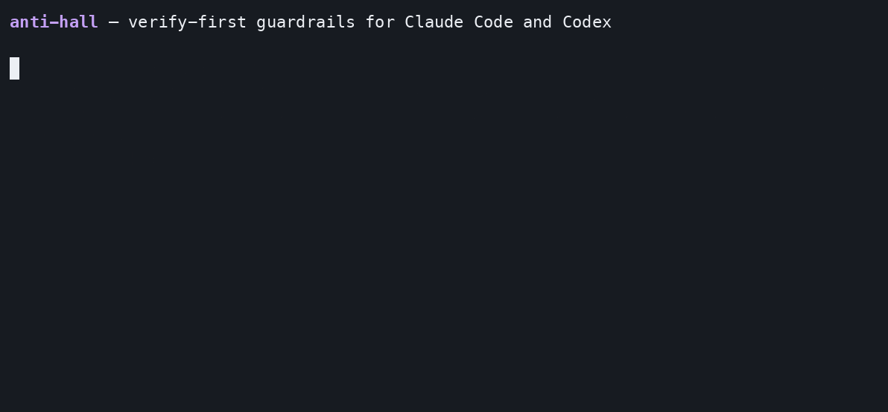

<div align="center">


# 🛡️ anti-hall

### Make Claude Code and Codex *verify before they claim* — with platform-native guardrails and workflow skills.

[](https://github.com/talas9/anti-hall/actions/workflows/test.yml) [](https://github.com/talas9/anti-hall/releases) [](LICENSE)    [](https://www.bestpractices.dev/projects/15357)

</div>

<p align="center">
  
</p>

## What it does

- Stops your coding assistant from stating things it has not checked: invented library functions, "it works" without running anything, "done" with tasks still open.
- Blocks risky git actions outright: force-pushes, and AI credit lines in commit messages and GitHub PR/issue/release text.
- Keeps the main conversation responsive by pushing heavy commands and file edits to helper agents, and caps runaway agent spawning.
- Adds skills you can call by name for debugging to a proven root cause, reviewing risky changes, and writing a session handover.
- Works with Claude Code (plugin) and Codex (separate port). The core is a small Rust engine (`ah-engine`), downloaded once and checked against a pinned sha256; a small Rust client, `ah-hook`, hands it every hook call. Node.js is not needed.

## Install

**Supported systems:** macOS and Linux, including WSL on Windows (it runs the Linux build). Native Windows is not supported yet.

**Claude Code:**

```bash
/plugin marketplace add talas9/anti-hall
/plugin install anti-hall@anti-hall
```

**Codex** (clone the repo, then run the installer; add `--global` for user-wide, `--dry-run` to preview):

```bash
git clone https://github.com/talas9/anti-hall.git && cd anti-hall
~/.anti-hall/ah-engine/bin/ah-engine install-codex
```

Add `.anti-hall/` to your project's `.gitignore`: anti-hall keeps per-project session notes there (or run `/anti-hall:doctor --repair`, which excludes it locally).

**Check it worked:** ask "is anti-hall working" (runs the `doctor` skill), or run `/anti-hall:settings`.

**Uninstall:** see the documentation (below).

### Enable Jev

<!-- jev-recommend:start -->
> **Recommended: enable Jev, the optional classifier, for more accurate guards.**
>
> It gives guards such as the speculation check a model's second opinion on top of pattern matching, and it can only add blocks, never remove one. **Costs:** optional and off by default; needs your own Vercel AI Gateway or TypeSafe API key; sends the text a guard judges to the provider you choose; uses provider credits. Details: [PRIVACY.md](PRIVACY.md).
>
> Enable: say "activate jev" (runs the `jev` skill). The full text and the measured result are in the Jev page of the documentation (below).
<!-- jev-recommend:end -->

## Network and data

No analytics and nothing is reported to anyone. One request is on by default: an update check to GitHub (a tag-list request, no project data; turn it off with `versionAlerts.antiHall`). Downloading the `ah-engine` binary from the GitHub Release (sha256-pinned) is opt-in: the setup skill or `sh hooks/install.sh --download` does it on request, and the setting `engine.bootstrap` = true (or `AH_ENGINE_BOOTSTRAP=1`) makes it automatic. The engine keeps local-only usage counters (hook name, outcome, latency, never content; `telemetry.enabled`). The optional classifier features (Jev, semantic judge, mesh triage) are off by default and send the text they judge only to the provider you configure. Everything else stays in `~/.anti-hall/` and `<repo>/.anti-hall/`. Full table: [PRIVACY.md](PRIVACY.md).

### What it runs and writes

These are the notable things it runs and writes outside the project. Hook state lives under `~/.anti-hall/` and `<project>/.anti-hall/`.

| What | When | Where |
|---|---|---|
| Background units (launchd agent / systemd user unit / cron entry) for the optional DevSwarm ingest daemon, liveness supervisor and MCP reaper | Only if you run the matching `install-*` script | `~/Library/LaunchAgents/`, `~/.config/systemd/user/` or your crontab |
| `claude plugin update anti-hall@anti-hall` | When you run `/anti-hall:update` and the harness registration is older than the latest release | the `claude` CLI |
| `claude -p --resume <session> --dangerously-skip-permissions` | Only when you run the on-demand `devswarm-recover` CLI for one workspace | the `claude` CLI |
| statusLine entry in `~/.claude/settings.json` | No longer written; `uninstall-statusline` only cleans old installs | `~/.claude/settings.json` |
| Launcher scripts that find the current plugin version | Written by the DevSwarm hooks in DevSwarm sessions | `~/.anti-hall/bin/` |
| Local reads of `~/.claude.json` (`userID`, Fable availability) and the OMC usage cache | By the limit-conservation and model-availability hooks; never sent anywhere | `~/.claude.json`, `~/.claude/plugins/oh-my-claudecode/.usage-cache-anthropic.json` |

## What it runs, sends and fetches

| | What happens |
|---|---|
| **Runs** | Hooks run on Claude Code tool events (one thin trigger per event: the `ah-hook` client, a small Rust binary). They read the event, decide, and print a verdict or a note. No hook sends project content anywhere. |
| **Fetches** | The `ah-engine` binary is downloaded once at install, only from this repository's GitHub releases. Its SHA-256 is pinned in `ah-engine.lock` and verified before the binary runs; a mismatch means it is not installed, and hooks let every call through with one notice per session. The only other request is the optional update check (a GitHub tag-list request, no project data). |
| **Sends** | Only if you turn on Jev (opt-in, off by default): review questions go to the one vendor whose API key you entered in the plugin options, and to no other. Nothing else is sent. No analytics, no telemetry upload; usage counters stay on your machine. |

Details and every setting: [PRIVACY.md](PRIVACY.md).

## Documentation

**[Documentation start page](docs/README.md)**: install and uninstall, what each guard blocks and how to turn it off, settings, Jev, DevSwarm, troubleshooting, contributing, security and the changelog.

Escape hatches, remaining limits and hook latency: [Limits and escape hatches](docs/GUIDE.md#limits-and-escape-hatches).

Building, testing and releasing the plugin and the Rust engine: [Development guide](docs/DEVELOPMENT.md).

## Links

- [Documentation](https://github.com/talas9/anti-hall/blob/main/docs/README.md)
- [Docs site](https://talas9.github.io/anti-hall/)
- [Support](https://github.com/talas9/anti-hall/issues)
- [Privacy](https://github.com/talas9/anti-hall/blob/main/PRIVACY.md)

## Roadmap

The ordered plan (engine back online, hardening, Node removal, features, then 1.0) with each release's exit gate is in [`docs/ROADMAP.md`](docs/ROADMAP.md).

**Later (parked): native Windows support** — anti-hall currently supports macOS and Linux (including WSL). Native Windows support is parked, not promised: it would need a Windows process-control layer and a non-shell hook wrapper in the Rust engine.

## License

MIT © Mohammed Talas. See [LICENSE](LICENSE).
